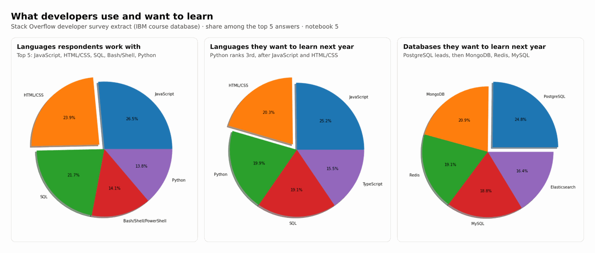
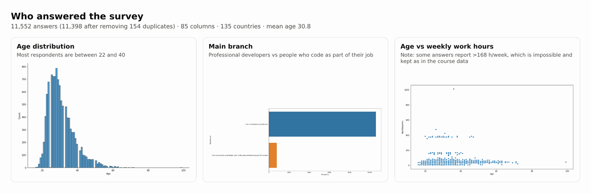
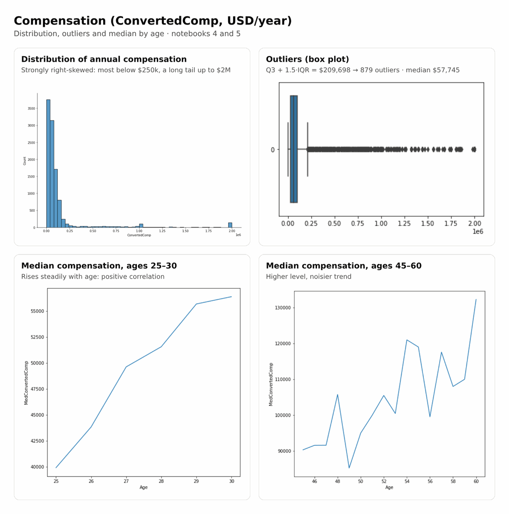
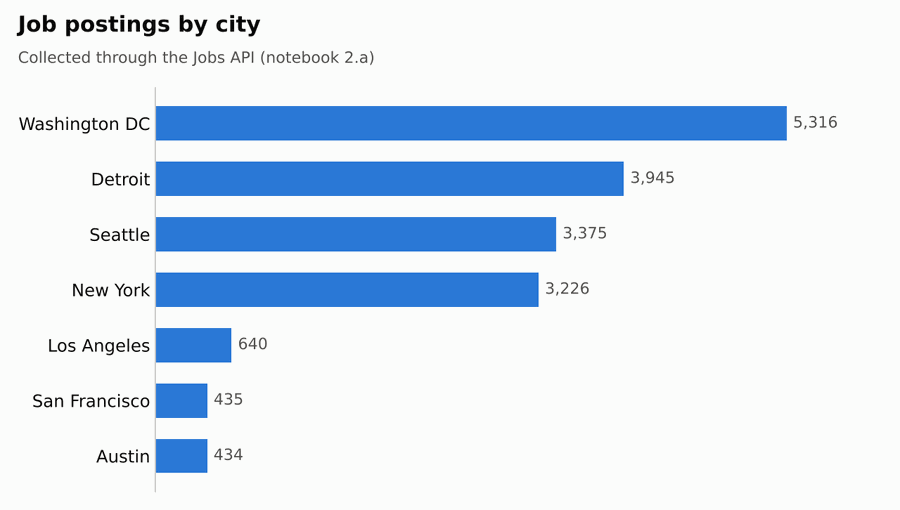
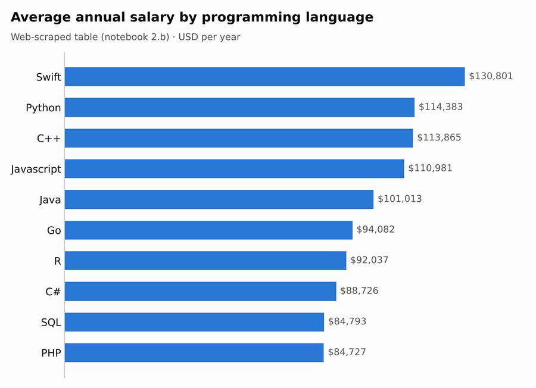

# IBM Data Analyst Capstone: Developer Survey & Tech Job Market

Capstone project of the **IBM Data Analyst Professional Certificate**. It analyses which programming languages, databases and skills developers use and want to learn, what they earn, and where tech jobs are. The full analyst workflow is covered in 7 notebooks: **collect** (REST API + web scraping) → **wrangle** → **explore** → **visualise**.

All charts below come from this repository: the notebook outputs as they were run, plus two charts drawn from the collected data files.



---

## Key findings
- **JavaScript, HTML/CSS and SQL** are the languages most respondents work with. Python is 5th today but **3rd among the languages people want to learn next year**.
- **PostgreSQL** is the database most respondents want to learn next, ahead of MongoDB, Redis and MySQL.
- Compensation is **heavily right-skewed**: median **$57,745**/year, and anything above **$209,698** (Q3 + 1.5 × IQR) is an outlier, which covers **879** respondents.
- Median compensation **rises steadily with age** from 25 to 30, and is higher but noisier from 45 to 60.
- Among the collected job postings, **Washington DC, Detroit, Seattle and New York** have the most. On the scraped salary table, **Swift, Python and C++** pay the most on average.

## 1. Who answered the survey


## 2. Compensation


## 3. Data collected through an API and web scraping
 

---

## Notebooks
| Notebook | Step | What it does |
|---|---|---|
| `1-Explore Data Set.ipynb` | Explore | First look at the survey: 11,552 rows × 85 columns, 135 countries |
| `2.a-Jobs_API.ipynb` | Collect | Small **Flask** REST API serving a job-postings dataset (`jobs.json`, from Naukri.com via Kaggle) |
| `2.a-Collect Data (API).ipynb` | Collect | Queries that API to count jobs per city and per technology, then saves the results to Excel |
| `2.b-Collect Data (WebScraping).ipynb` | Collect | Scrapes a table of average salary per language with BeautifulSoup and saves it to CSV |
| `3-DataWrangling-.ipynb` | Wrangle | Removes 154 duplicates (11,398 rows left), imputes missing values, normalises compensation to yearly |
| `4-ExploratoryDataAnalysis.ipynb` | Explore | Distributions, IQR outliers, correlations |
| `5-DataVisualization.ipynb` | Visualise | SQL queries on the SQLite survey database, then histograms, box, scatter, bubble, pie, stacked and line charts |

Collected data is included: `2.a-job-postings (Collected from API).xlsx`, `2.a-job-postings-languages (Collected from API).xlsx` and `2.b-popular-languages(Collected from WebScraping).csv`.

## Data-quality notes
- **Technology counts from the API:** the original counting function uses a case-sensitive *substring* search. So "C" also matches C#, C++ and CSS, "Java" also matches JavaScript, and "MySQL Server" finds 0. The counts for C and Java in `2.a-job-postings-languages…xlsx` are therefore inflated. Notebook 2.a now has a note and a corrected `get_number_of_jobs_T_exact` function that matches whole skills, so you can re-run and regenerate the file. That's also why the README doesn't chart those counts.
- **Weekly work hours:** a few survey answers report more than 168 hours/week, which is impossible. They're kept as they appear in the course data (visible in the age vs hours scatter).
- **Pie charts** show each item's share **among the top 5 answers**, not among all respondents.

## Run it
```bash
pip install pandas numpy matplotlib seaborn requests beautifulsoup4 html5lib openpyxl flask jupyter
jupyter notebook
```
Notebooks 1, 3, 4 and 5 download the survey data from IBM's public course storage. For notebook 2.a, first run `2.a-Jobs_API.ipynb` (it starts the Flask API on port 5000), then `2.a-Collect Data (API).ipynb`. **No API keys are needed.**

## Tech
Python · pandas · NumPy · Matplotlib · Seaborn · SQLite · Flask · requests · BeautifulSoup · openpyxl · Jupyter

**Author:** Rodrigo Chemite Barbosa · [github.com/ch3m1bb5](https://github.com/ch3m1bb5)
